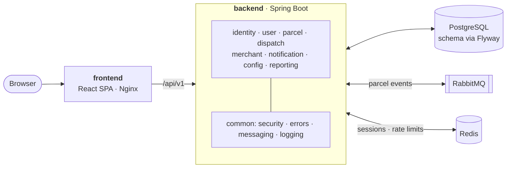

<div align="center">

# SwiftDrop

**Parcel delivery and courier management, from booking to doorstep.**

[](https://github.com/dinithrathnayaka23/swiftdrop/actions/workflows/ci.yml)


[](LICENSE)

[Overview](#overview) •
[Architecture](#architecture) •
[Getting started](#getting-started) •
[Development](#local-development) •
[Testing](#testing) •
[Contributing](#contributing)

</div>

---

## Overview

SwiftDrop is a web platform that connects everyone involved in getting a parcel from A to B:

| Who | What they do |
|-----|--------------|
| **Customers** | Book deliveries, get an instant fee estimate and follow their parcels in real time |
| **Merchants** | Push orders through a REST API with API keys and receive status updates via webhooks |
| **Dispatchers / Admins** | Assign parcels to couriers, manage zones and pricing, approve merchants and view reports |
| **Couriers** | See their jobs, update delivery status and record proof of delivery or failure reasons |
| **Anyone** | Track a parcel publicly with its tracking number |

Status changes flow through an event bus, so notifications (email, SMS, live updates) and merchant webhooks
happen asynchronously without slowing down the core workflow.

> [!NOTE]
> The project is in its **foundation stage**: infrastructure, security baseline, module structure and the UI shell
> are in place, and features are being built module by module.

## Architecture

SwiftDrop is a **layered modular monolith**: a single Spring Boot application divided into well-bounded
feature modules, with a separate React single-page application in front of it.



**Design principles**

- **Modules own their data.** Each module exposes services (and events); other modules never reach into its repositories or entities.
- **Thin controllers, rich services.** Controllers validate and map DTOs; business rules live in services.
- **Secure by default.** Short-lived JWT access tokens, a refresh token only in an httpOnly cookie backed by a server-side session in Redis (so sign-out takes effect immediately), rate limits on every sign-in endpoint, role-based method security, and every route private unless explicitly public.
- **Asynchronous side effects.** Parcel status changes are published to RabbitMQ; notifications and webhooks consume them, with a dead-letter queue for failures.
- **Schema as code.** Flyway migrations are the single source of truth; Hibernate only validates.
- **Privacy first.** No stack traces or personal data in API errors, and personal data is never logged.

### Backend modules

| Module | Responsibility |
|--------|----------------|
| `identity` | Sign-up, login, JWT issuing, Google OAuth |
| `user` | Profiles, roles, merchant approval |
| `parcel` | Booking, fee estimation, parcel lifecycle, public tracking |
| `dispatch` | Courier assignment, status updates, proof of delivery and failures |
| `merchant` | API keys, merchant order API, webhooks |
| `notification` | Event consumers, email / SMS, live updates |
| `config` | Delivery zones and pricing rules |
| `reporting` | Operational and business reports |

## Tech stack

| Area | Technologies |
|------|--------------|
| **Backend** | Java 25, Spring Boot 4.1 (Web MVC, Validation, Data JPA, Security, OAuth2 Client, AMQP, WebSocket, Mail, Actuator), springdoc-openapi, Lombok |
| **Frontend** | React 19, TypeScript 6, Vite 8, Tailwind CSS 4, React Router 8, Axios |
| **Data & messaging** | PostgreSQL 18, Flyway, RabbitMQ 4, Redis 8 |
| **Testing** | JUnit 6, Mockito, Spring Boot Test, Spring Security Test, Testcontainers, JaCoCo, Jest, React Testing Library |
| **Tooling** | Maven Wrapper, ESLint, Prettier, Docker Compose, GitHub Actions |

## Getting started

### Prerequisites

| Tool | Version | Required for |
|------|---------|--------------|
| [Docker Desktop](https://www.docker.com/products/docker-desktop/) | Compose v2+ | Running the stack and integration tests |
| [JDK](https://adoptium.net/) | 25 (LTS) | Backend development |
| [Node.js](https://nodejs.org/) | 24 LTS (22.22+) | Frontend development |

Maven is optional: the repository ships with the Maven Wrapper (`./mvnw`).
PostgreSQL, RabbitMQ and Redis run in Docker; nothing else needs to be installed.

### Run the full stack

```bash
git clone https://github.com/dinithrathnayaka23/swiftdrop.git
cd swiftdrop
cp .env.example .env            # PowerShell: Copy-Item .env.example .env
docker compose up --build
```

Once all containers report **healthy**:

| Service | URL |
|---------|-----|
| Web app | http://localhost:3000 |
| API health | http://localhost:8080/api/v1/health |
| API docs (Swagger UI, dev profile) | http://localhost:8080/swagger-ui.html |
| Actuator health | http://localhost:8080/actuator/health |
| RabbitMQ management | http://localhost:15672 |
| Mailpit (emails sent by the app) | http://localhost:8025 |
| PostgreSQL | `localhost:5432` |
| Redis | `localhost:6379` |

Credentials for PostgreSQL, RabbitMQ and Redis are the ones in your `.env`.

> [!TIP]
> **First sign-in:** SwiftDrop has a single admin whose credentials are `ADMIN_EMAIL` / `ADMIN_PASSWORD` in `.env`
> (required; synced on every startup, so edit `.env` and restart to change them). Sign in at `/admin/login`. Couriers sign in at `/courier/login` (built for phones).
> Customers and merchants register from the web app; merchants can sign in once an admin approves them.
> Password reset and approval emails appear in Mailpit. Parcel tracking still uses sample data
> (`SD123456789`, `SD987654321`) until the tracking API is built (`VITE_USE_MOCK_API`).

Stop everything with `docker compose down` (add `-v` to also delete the database and broker data).

## Local development

For day-to-day work, run the infrastructure in Docker and the applications on your machine:

```bash
docker compose up -d postgres rabbitmq redis
```

**Backend** (http://localhost:8080). The `dev` profile automatically reads the repository's `.env`:

```bash
cd backend
./mvnw spring-boot:run -Dspring-boot.run.profiles=dev     # Windows: mvnw.cmd
```

**Frontend** (http://localhost:5173, with `/api` proxied to the backend):

```bash
cd frontend
npm install
npm run dev
```

<details>
<summary><b>Prefer hot reload inside Docker?</b></summary>

```bash
docker compose -f docker-compose.yml -f docker-compose.dev.yml up
```

Runs the Vite dev server with HMR on port 5173 and the backend from source.
Restart the `backend` service to pick up Java changes.

</details>

## Configuration

All configuration is supplied through environment variables; see [`.env.example`](.env.example) for the full list.
Secrets are never committed: `.env` is git-ignored.

| Variable | Purpose |
|----------|---------|
| `SPRING_PROFILES_ACTIVE` | `dev` locally (enables Swagger, reads `.env`) |
| `POSTGRES_DB`, `POSTGRES_USER`, `POSTGRES_PASSWORD`, `SPRING_DATASOURCE_URL` | Database connection |
| `RABBITMQ_HOST`, `RABBITMQ_PORT`, `RABBITMQ_USER`, `RABBITMQ_PASSWORD` | Message broker connection |
| `JWT_SECRET`, `JWT_EXPIRY` | Token signing key (≥ 32 chars) and access token lifetime in seconds (default 900) |
| `REDIS_HOST`, `REDIS_PORT`, `REDIS_PASSWORD` | Redis: sign-in sessions, rate limits, reset-email cooldown |
| `AUTH_COOKIE_SECURE` | Session cookie only over HTTPS (browsers allow it on `http://localhost`) |
| `RATE_LIMIT_ENABLED` | Per-IP and failed-sign-in limits on `/api/v1/auth` |
| `GOOGLE_CLIENT_ID` | Sign in with Google (OAuth Client ID; empty hides the button) |
| `MAIL_HOST`, `MAIL_PORT`, `MAIL_USERNAME`, `MAIL_PASSWORD`, `MAIL_FROM` | Outgoing email (Mailpit in Docker) |
| `FRONTEND_URL` | Allowed CORS origin(s), comma-separated |
| `VITE_USE_MOCK_API` | Sample parcel tracking data until the tracking API exists (sign-in always uses the backend) |
| `ADMIN_EMAIL`, `ADMIN_PASSWORD`, `ADMIN_FULL_NAME` | First admin account, created on startup if it doesn't exist |
| `FRONTEND_BASE_URL`, `PASSWORD_RESET_EXPIRY` | Web app address used in email links; reset link lifetime (seconds) |
| `REFRESH_TOKEN_EXPIRY_REMEMBER_ME`, `REFRESH_TOKEN_EXPIRY_SESSION` | Session length with / without "Remember me" (seconds; default 30 days / 1 day) |

> [!IMPORTANT]
> The values in `.env.example` are for local development only. Generate a strong `JWT_SECRET`
> (`openssl rand -base64 48`) and unique passwords for any shared or hosted environment.

## Testing

```bash
# Backend: unit tests, Testcontainers integration tests and coverage (requires Docker)
cd backend
./mvnw verify

# Frontend: lint, unit tests and production build
cd frontend
npm run lint
npm test
npm run build
```

| Report | Location |
|--------|----------|
| Backend coverage (JaCoCo) | `backend/target/site/jacoco/index.html` |
| Frontend coverage | `frontend/coverage/index.html` (`npm run test:coverage`) |

Every pull request is checked by [GitHub Actions](.github/workflows/ci.yml): backend build and tests with coverage,
frontend lint, format, test and build, and Docker image builds.

## Project structure

```
swiftdrop/
├── backend/                         Spring Boot application
│   ├── src/main/java/com/swiftdrop/
│   │   ├── common/                  Shared: security (JWT), error handling, messaging, logging, CORS
│   │   └── <module>/                identity, user, parcel, dispatch, merchant, notification, config, reporting
│   │       ├── controller/          REST endpoints
│   │       ├── service/             Business logic, the module's public entry point
│   │       ├── repository/          Data access (private to the module)
│   │       ├── model/               JPA entities and enums
│   │       ├── dto/                 Request and response records
│   │       ├── mapper/              Entity ↔ DTO mapping
│   │       ├── exception/           Module-specific exceptions
│   │       └── event/               Message publishers and listeners
│   └── src/main/resources/
│       ├── application*.yml         Configuration profiles
│       └── db/migration/            Flyway migrations
├── frontend/                        React single-page application
│   └── src/
│       ├── api/                     Axios client and API calls
│       ├── components/  layouts/    Shared UI and page shells
│       ├── pages/                   auth, customer, merchant, courier, dispatcher, admin, public
│       ├── routes/                  Routing and role-based guards
│       └── context/  hooks/  types/  utils/
├── docs/                            Contributing guide and API conventions
├── docker/                          Additional Docker configuration
├── .github/                         CI workflow and PR template
├── docker-compose.yml               Full stack
├── docker-compose.dev.yml           Hot-reload override
└── .env.example                     Environment template
```

## API at a glance

- Base path: **`/api/v1`**. Interactive documentation at `/swagger-ui.html` (dev profile).
- Authentication: `Authorization: Bearer <JWT>`. Roles: `CUSTOMER`, `MERCHANT`, `COURIER`, `DISPATCHER_ADMIN`.
- Public endpoints: `/api/v1/auth/**`, `/api/v1/public/tracking/**`, `/api/v1/health`.
- Errors share one format:

```json
{
  "timestamp": "2026-01-01T10:00:00Z",
  "status": 400,
  "error": "Bad Request",
  "code": "VALIDATION_FAILED",
  "message": "Request validation failed",
  "path": "/api/v1/parcels",
  "fieldErrors": [{ "field": "weightKg", "message": "must be greater than 0" }]
}
```

Full conventions: [docs/API_CONVENTIONS.md](docs/API_CONVENTIONS.md).

### Authentication

Email and password sign-in with stateless JWTs (Google sign-in is planned).

| Endpoint | Access | Purpose |
|----------|--------|---------|
| `POST /api/v1/auth/register/customer` | Public | Create a customer account and sign in (201 + token) |
| `POST /api/v1/auth/register/merchant` | Public | Submit a business for approval (201, no token until approved) |
| `POST /api/v1/auth/login` | Public | Sign in. 401 for wrong credentials, 403 if pending approval, disabled, or on another role's sign-in page (`portal`: `PUBLIC` default, `COURIER`, `ADMIN`) |
| `POST /api/v1/auth/refresh` | Public (refresh token) | New access + refresh token pair; the web app calls it automatically |
| `POST /api/v1/auth/password-reset` | Public | Email a reset link (always 202, so emails can't be discovered) |
| `POST /api/v1/auth/password-reset/confirm` | Public | Set a new password with the emailed token (single use, 30 min) |
| `GET /api/v1/users/me` | Any signed-in user | Own profile |
| `GET /api/v1/admin/merchants?status=PENDING` | `DISPATCHER_ADMIN` | Merchants awaiting review |
| `POST /api/v1/admin/merchants/{id}/approve` · `/reject` | `DISPATCHER_ADMIN` | Approve (activates the merchant's sign-in) or reject with a reason |

Sessions: sign-in returns a 1-hour **access token** and a **refresh token**. The web app renews the access
token in the background, so users stay signed in while the refresh token is valid: **30 days with
"Remember me"** (renewed on every use, kept after the browser closes) or **at most 1 day without it** (forgotten
when the browser closes). Changing the password ends all existing sessions.

Passwords are stored as BCrypt hashes. There is exactly one admin (enforced by a unique index), and its
credentials are always `ADMIN_EMAIL` / `ADMIN_PASSWORD`: no self-registration and no password reset by email. Couriers will be created by admins (dispatch module).

Each role has its own sign-in page, and the backend refuses a sign-in on the wrong one (`WRONG_SIGN_IN_PAGE`,
only after the correct password): customers and merchants at `/login`, couriers at `/courier/login`, admins at
`/admin/login`. Google sign-in is only on the main page, so staff always use their password.

## Contributing

1. Branch from `main`: `feature/<short-name>`, `fix/<short-name>` or `chore/<short-name>`.
2. Write [Conventional Commits](https://www.conventionalcommits.org/), e.g. `feat(parcel): add fee estimate endpoint`.
3. Add database changes as a **new** Flyway migration; never edit a merged one.
4. Open a pull request using the template; CI must pass and at least one review is required.

Read the full guide in [docs/CONTRIBUTING.md](docs/CONTRIBUTING.md) before your first pull request.

## Acknowledgements

Developed by **Group 32 · Code_Crafters** for *IN3101 Enterprise Application Development*,
University of Moratuwa.

## License

Released under the [MIT License](LICENSE).
